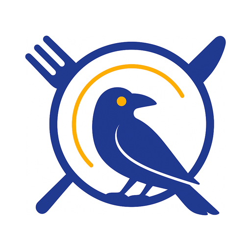
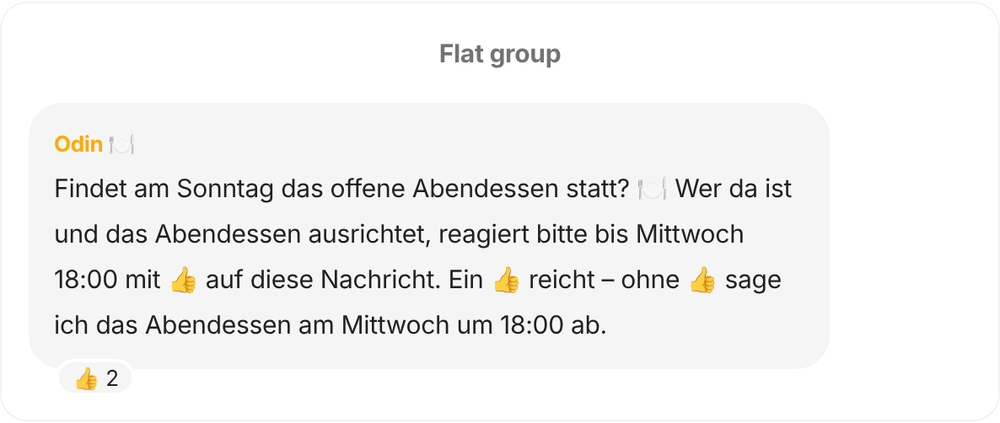

  

# ODIN — Open Dinner Invitation Notifier

ODIN is a Signal bot that organises a weekly open Sunday dinner. Every week it asks the flat
group whether dinner takes place, announces it to the dinner group (or cancels it when nobody
hosts), and collects a rough head count so there is enough food. Flatmates can check and change
its settings with chat commands such as `/status` or `/cancel`; all texts it posts are templates
in a config file.

<!-- Chat mock rendered from the docs site's landing page; replace with a real Signal screenshot
     once #113 has landed. -->

  

## Quickstart

ODIN runs as two rootless podman containers (the bot and a Signal API) on any Debian machine,
with its own phone number. [First deployment](https://emrys-merlin.github.io/odin/tutorials/first-deployment/)
takes you from a fresh machine to ODIN's first question in the flat group in about an hour.

## Documentation

Everything else is on the docs site, **<https://emrys-merlin.github.io/odin/>**:

| | For | Start with |
|---|---|---|
| **[Tutorials](https://emrys-merlin.github.io/odin/tutorials/)** | learning by doing | [First deployment](https://emrys-merlin.github.io/odin/tutorials/first-deployment/), [Your first week with ODIN](https://emrys-merlin.github.io/odin/tutorials/first-week/) |
| **[How-to guides](https://emrys-merlin.github.io/odin/how-to/)** | one task at a time | [operate](https://emrys-merlin.github.io/odin/how-to/operate/upgrade/), [in the chat](https://emrys-merlin.github.io/odin/how-to/chat/cancel-dinner/), [develop](https://emrys-merlin.github.io/odin/how-to/develop/run-locally/) |
| **[Reference](https://emrys-merlin.github.io/odin/reference/)** | looking things up | [CLI](https://emrys-merlin.github.io/odin/reference/cli/), [chat commands](https://emrys-merlin.github.io/odin/reference/chat-commands/), [templates](https://emrys-merlin.github.io/odin/reference/templates/), [configuration](https://emrys-merlin.github.io/odin/reference/configuration/), [deployment units](https://emrys-merlin.github.io/odin/reference/deployment-units/) |
| **[Explanation](https://emrys-merlin.github.io/odin/explanation/)** | understanding why | [the weekly cycle](https://emrys-merlin.github.io/odin/explanation/weekly-cycle/), [reliability](https://emrys-merlin.github.io/odin/explanation/reliability/), [design goals](https://emrys-merlin.github.io/odin/explanation/design-goals/) |

## Contributing

Work is tracked in GitHub issues. Start with [`CLAUDE.md`](CLAUDE.md) (workflow, commands, design
rules) and the [develop how-tos](https://emrys-merlin.github.io/odin/how-to/develop/run-locally/).

## License

See [LICENSE](LICENSE).
