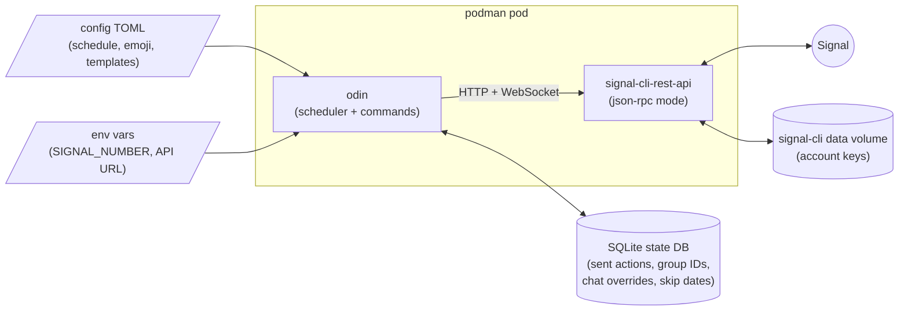

# Architecture

**Explanation** — background: how ODIN behaves and why.

How ODIN is built: the Signal sidecar, interfaces, config and state.

## The package

ODIN is a **Python 3.14** package managed with **uv** (src layout, package `odin`).

## Signal access

Signal access goes through **`bbernhard/signal-cli-rest-api`** in `json-rpc` mode, running as a
sidecar container. ODIN talks to it over HTTP + WebSocket with a thin own client behind an
interface. Keeping Signal's protocol in a maintained sidecar means ODIN never handles Signal's
cryptography itself, and the sidecar can be updated independently.

## Interfaces for Signal and time

The Signal client and the clock are interfaces. A **fake client** implements the same interface
as the real one for tests, and time is injected, so the weekly cycle is tested by time travel,
fully offline: a test sets the clock to Tuesday 18:00, ticks, and checks that the flat ask went
out. No test touches the network or the real time. This is also why development works in a
sandbox with no Signal account at all.

The scheduler itself is a reconcile loop over (config, state, now) — see
[Reliability](reliability.md).

## Config, env vars and state

Settings come from three places, each for a different kind of value:

- **Config file** — a TOML file mounted into the container: schedule, emoji, templates. What the
  flat might want to change. See [Configuration](../reference/configuration.md).
- **Env vars** — deployment-specific values: `SIGNAL_NUMBER`, the signal API URL. What differs
  between installations and must not be in the repo.
- **State DB** (SQLite) — what ODIN learns while running: every sent action, the group IDs, and
  the changes flatmates make from the chat, including the skip dates set with `/skip`. The group IDs are chosen in `odin setup` and stored
  there; `FLAT_GROUP_ID` / `DINNER_GROUP_ID` env vars override them when set. Until ODIN is set
  up, `odin run` waits instead of failing.

Chat changes (a moved time, an edited text) are stored as overrides in the state DB and win over
the config file; resetting them falls back to the file.

## Secrets

There are no secrets in the repo. The phone number comes from an env var; the group IDs are
picked in `odin setup` after ODIN is added to both groups. The only real secret is the
signal-cli data volume, created at registration: it holds the account keys. Registration also
needs a one-time captcha token from signalcaptchas.org. No API tokens are needed: the GHCR image
is public, and the Signal API container is only reachable inside the pod.

## Deployment

Every merge to `main` is a semver release: CI tags `vX.Y.Z`, creates a GitHub Release and pushes
the container image to **GHCR** (public package; it contains no secrets) as `X.Y.Z`, `X.Y`, `X`,
`latest` and the commit SHA. `release:none` merges publish nothing. We stay on `0.x` until the
bot goes live; going live is a `release:major` PR → `1.0.0`. See
[Release](../how-to/develop/release.md).

ODIN runs on a homelab **Debian 13 VM on Proxmox** (general container VM, ~1 vCPU / 1.5 GB RAM /
10 GB), under **rootless podman** as a dedicated `odin` user with lingering. **Quadlet** units
define a pod (signal-cli-rest-api + odin), and **`podman auto-update`** follows the GHCR image.
The unit follows the **major tag** (`ghcr.io/emrys-merlin/odin:0` now, `:1` after going live),
not `:latest`, so auto-update never pulls a breaking release on its own; a major bump means
editing the unit by hand. Details: [Deployment units](../reference/deployment-units.md).

The signal-cli data volume **must be backed up** (the Proxmox VM backup covers it). Losing it
means re-registering the number. See [Back up and restore](../how-to/operate/backup-restore.md).

## Quality gates

ruff (lint + format), ty (types) and pytest. ruff and ty run as **prek** hooks; CI runs
`prek run --all-files` and pytest on every PR. See [Run locally](../how-to/develop/run-locally.md).
