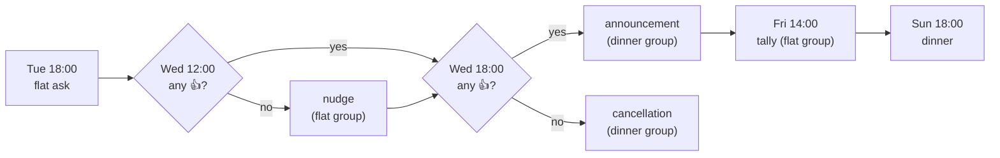

# The weekly cycle

**Explanation** — background: how ODIN behaves and why.

What happens when in a dinner week, and why.

## The problem

Every Sunday evening people can come to our flat share and have dinner together. Two questions
need answering each week:

1. **Does dinner take place?** Sometimes nobody from the flat is home — then guests must be told
   it is cancelled.
2. **How much food do we need?** If dinner happens, we need a rough head count by Friday afternoon
   to order food.

ODIN answers both with a fixed weekly rhythm of messages and 👍 reactions, so nobody has to
remember to ask.

## Two groups

ODIN is a member of two Signal groups:

- **Flat group** — the flatmates. Decides whether dinner happens.
- **Dinner group** — everyone invited (all flatmates are in it too). Receives the announcement.

The split keeps the decision among the people who host: guests only ever see the outcome, never
the question.

## The week

All times are configurable (see [Configuration](../reference/configuration.md)); the defaults
are below, timezone `Europe/Berlin`.

| When (default) | Group  | Action |
|----------------|--------|--------|
| Tue 18:00      | flat   | Ask whether dinner takes place this Sunday; react 👍 to confirm. Deadline: Wed 18:00. |
| Wed 12:00      | flat   | *Nudge* — only if there is no 👍 yet: "nobody confirmed, dinner will be cancelled at 18:00". Can be disabled. |
| Wed 18:00      | dinner | **No 👍** → bilingual cancellation. **≥1 👍** → bilingual announcement + RSVP request (see below). |
| Fri 14:00      | flat   | Tally — only if dinner is on: number of 👍 reactions on the dinner announcement. |

The flat ask goes out on Tuesday evening, when most flatmates know their weekend plans. One
👍 is enough: dinner needs one host, not a quorum.

Odin 🍽️
Findet am Sonntag das offene Abendessen statt? 🍽️
Wer da ist und das Abendessen ausrichtet, reagiert bitte bis Mittwoch 18:00 mit 👍 auf diese
Nachricht. Ein 👍 reicht – ohne 👍 sage ich das Abendessen am Mittwoch um 18:00 ab.
👍 1

The **nudge** on Wednesday noon only goes out if nobody has confirmed yet — a reminder that
silence means cancellation, not a second poll. It can be turned off (see
[Pause the nudge](../how-to/chat/pause-nudge.md)).

The **decision** on Wednesday evening leaves guests four days' notice either way. Without a 👍
the dinner group gets a cancellation; with one it gets the announcement.

The announcement asks guests to react 👍 if they are coming, **please by Fri 14:00** (we order
food then) — not a hard deadline, reactions after it are fine. It states two times: **17:00** for
anyone who wants to help cook (explicitly optional — helping is absolutely no requirement) and
**18:00** otherwise. Plus-ones are mentioned in a reply by the guest and counted by humans.

Odin 🍽️
Diesen Sonntag gibt es offenes Abendessen! 🍽️
Essen gibt es um 18:00. Wer mag, kann schon um 17:00 kommen und beim Kochen helfen – das ist
völlig freiwillig und überhaupt keine Voraussetzung.
Wenn du kommst, reagiere bitte mit 👍 auf diese Nachricht, am besten bis Freitag 14:00 – dann
bestellen wir das Essen. Bringst du jemanden mit? Dann schreib das bitte als Antwort auf diese
Nachricht.

Open dinner this Sunday! 🍽️
Dinner is at 18:00. If you like, come at 17:00 and help cook – that is entirely optional and
absolutely no requirement.
If you are coming, please react with 👍 to this message, ideally by Friday 14:00 – that is when
we order the food. Bringing someone? Please say so in a reply to this message.
👍 7

The **tally** on Friday afternoon tells the flat group how many 👍 the announcement has, which is
when food gets ordered. It is a rough count on purpose: plus-ones stay in the replies, and late
reactions are still welcome.

All texts are templates in the config, so the flat can reword them without a release (see
[Templates](../reference/templates.md) and [Edit a text](../how-to/chat/edit-a-text.md)).
Which reactions count is explained in [Reactions](reactions.md).

## Cancelling from the chat

Sometimes dinner was confirmed and then falls through. `/cancel` in the flat group cancels the
current dinner week (the one whose dinner has not started yet) after a confirmation. ODIN replies
with the cancellation it would post and asks for the configured emoji on that reply; the reply is
tracked like the flat poll. As soon as anyone in the flat group reacts with it (the requester
too), ODIN posts the normal bilingual cancellation template to the dinner group on its next tick
and records it as the week's cancellation, so the dinner group never gets two.

How the cancellation fits into the week depends on when it comes:

- **Before the flat deadline** it replaces the decision: an open flat ask or nudge is skipped.
- **After an announcement** it follows it, and an open tally is skipped.
- A cancelled week needs no reactions any more, so an untracked flat poll is not asked again and
  an untracked announcement gets no notice (see [Reliability](reliability.md)).

A request that nobody confirms does nothing; it lapses when the week's dinner starts. `/cancel`
is refused once the cancellation went out (or was skipped as too late), for a week dropped by a
[dinner weekday change](weekday-change.md), and while a request of this week is open.

Steps: [Cancel a dinner](../how-to/chat/cancel-dinner.md). Exact syntax:
[Chat commands](../reference/chat-commands.md).
