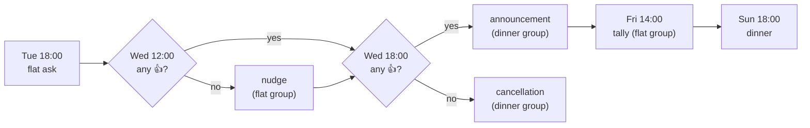

# The weekly cycle

**Explanation** — background: how ODIN behaves and why.

What happens when in a dinner week, and why.

## The problem

Every Sunday evening people can come to our flat share and have dinner together. Two questions
need answering each week:

1. **Does dinner take place?** Sometimes nobody from the flat is home — then guests must be told
   it is cancelled.
2. **How much food do we need?** If dinner happens, we need a rough head count by Friday afternoon
   to order food.

ODIN answers both with a fixed weekly rhythm of messages and 👍 reactions, so nobody has to
remember to ask.

## Two groups

ODIN is a member of two Signal groups:

- **Flat group** — the flatmates. Decides whether dinner happens.
- **Dinner group** — everyone invited (all flatmates are in it too). Receives the announcement.

The split keeps the decision among the people who host: guests only ever see the outcome, never
the question.

## The week

All times are configurable (see [Configuration](../reference/configuration.md)); the defaults
are below, timezone `Europe/Berlin`.

| When (default) | Group  | Action |
|----------------|--------|--------|
| Tue 18:00      | flat   | Ask whether dinner takes place this Sunday; react 👍 to confirm. Deadline: Wed 18:00. |
| Wed 12:00      | flat   | *Nudge* — only if there is no 👍 yet: "nobody confirmed, dinner will be cancelled at 18:00". Can be disabled. |
| Wed 18:00      | dinner | **No 👍** → bilingual cancellation. **≥1 👍** → bilingual announcement + RSVP request (see below). |
| Fri 14:00      | flat   | Tally — only if dinner is on: number of 👍 reactions on the dinner announcement. |

The flat ask goes out on Tuesday evening, when most flatmates know their weekend plans. One
👍 is enough: dinner needs one host, not a quorum.

Odin 🍽️
Findet am Sonntag das offene Abendessen statt? 🍽️
Wer da ist und das Abendessen ausrichtet, reagiert bitte bis Mittwoch 18:00 mit 👍 auf diese
Nachricht. Ein 👍 reicht – ohne 👍 sage ich das Abendessen am Mittwoch um 18:00 ab.
👍 1

The **nudge** on Wednesday noon only goes out if nobody has confirmed yet — a reminder that
silence means cancellation, not a second poll. It can be turned off (see
[Pause the nudge](../how-to/chat/pause-nudge.md)).

The **decision** on Wednesday evening leaves guests four days' notice either way. Without a 👍
the dinner group gets a cancellation; with one it gets the announcement.

The announcement asks guests to react 👍 if they are coming, **please by Fri 14:00** (we order
food then) — not a hard deadline, reactions after it are fine. It states two times: **17:00** for
anyone who wants to help cook (explicitly optional — helping is absolutely no requirement) and
**18:00** otherwise. Plus-ones are mentioned in a reply by the guest and counted by humans.

Odin 🍽️
Diesen Sonntag gibt es offenes Abendessen! 🍽️
Essen gibt es um 18:00. Wer mag, kann schon um 17:00 kommen und beim Kochen helfen – das ist
völlig freiwillig und überhaupt keine Voraussetzung.
Wenn du kommst, reagiere bitte mit 👍 auf diese Nachricht, am besten bis Freitag 14:00 – dann
bestellen wir das Essen. Bringst du jemanden mit? Dann schreib das bitte als Antwort auf diese
Nachricht.

Open dinner this Sunday! 🍽️
Dinner is at 18:00. If you like, come at 17:00 and help cook – that is entirely optional and
absolutely no requirement.
If you are coming, please react with 👍 to this message, ideally by Friday 14:00 – that is when
we order the food. Bringing someone? Please say so in a reply to this message.
👍 7

The **tally** on Friday afternoon tells the flat group how many 👍 the announcement has, which is
when food gets ordered. It is a rough count on purpose: plus-ones stay in the replies, and late
reactions are still welcome.

All texts are templates in the config, so the flat can reword them without a release (see
[Templates](../reference/templates.md) and [Edit a text](../how-to/chat/edit-a-text.md)).
Which reactions count is explained in [Reactions](reactions.md).

## Cancelling from the chat

Sometimes dinner was confirmed and then falls through. `/cancel` in the flat group cancels the
current dinner week (the one whose dinner has not started yet) after a confirmation. ODIN replies
with the cancellation it would post and asks for the configured emoji on that reply; the reply is
tracked like the flat poll. As soon as anyone in the flat group reacts with it (the requester
too), ODIN posts the normal bilingual cancellation template to the dinner group on its next tick
and records it as the week's cancellation, so the dinner group never gets two.

How the cancellation fits into the week depends on when it comes:

- **Before the flat deadline** it replaces the decision: an open flat ask or nudge is skipped.
- **After an announcement** it follows it, and an open tally is skipped.
- A cancelled week needs no reactions any more, so an untracked flat poll is not asked again and
  an untracked announcement gets no notice (see [Reliability](reliability.md)).

A request that nobody confirms does nothing; it lapses when the week's dinner starts. `/cancel`
is refused once the cancellation went out (or was skipped as too late), for a week dropped by a
[dinner weekday change](weekday-change.md), while a request of this week is open, and during a
[hiatus](#taking-a-break).

Steps: [Cancel a dinner](../how-to/chat/cancel-dinner.md). Exact syntax:
[Chat commands](../reference/chat-commands.md).

## Introducing ODIN

Guests only ever see ODIN's announcements and cancellations; nobody tells them what ODIN is or
how to answer it. `/introduce` in the flat group posts a short self-introduction, the
`introduction` template, to the dinner group: when ODIN joins it, or when new people did. Like
`/cancel` it needs a confirmation: ODIN replies with the text and asks for the configured emoji,
and posts on its next tick once someone reacts.

It is not part of the week. It can be sent any number of times, changes nothing in the weekly
cycle and does not show in `/status`. Each confirmed request is recorded once posted, so it goes
out once however often people react, and a later `/introduce` posts it again.

Steps: [Introduce ODIN to the dinner group](../how-to/chat/introduce-odin.md).

## Skipping a date in advance

Some Sundays are known to be off long before: holidays, everyone away. `/skip` with the date
enters such a *skip date* in the state DB; it is set from the chat only, there is no config key
for it. No reaction is needed — a date weeks ahead is a plan, not a last-minute call, and
`/unskip` takes it back.

A skipped week runs like a cancelled one, but on the usual schedule:

- The flat ask and the nudge are not sent. Nobody needs to confirm a dinner that is not
  happening, so the flat group is not asked.
- The cancellation goes to the dinner group at the usual decision time (Wed 18:00 by default),
  not when the date is entered. Guests hear about every Sunday at the same point in the week, and
  the template's "this Sunday" stays true.
- The tally is skipped, as after any cancellation.

The flat ask is only marked as skipped at its time, so `/unskip` works until then; after it the
week stays cancelled, because nobody was asked.

Once a week's flat ask has gone out, the flat is deciding that week already, and skipping it is
the same thing as `/cancel`: `/skip` with this week's date answers exactly as `/cancel` does
(confirmation by reaction, the same cancellation, sent once). There is one way to cancel a running
week, not two. Conversely, `/cancel` is refused in a skipped week, since its cancellation goes out
anyway.

A skip date names a dinner day, so it must fall on the dinner weekday — the new one after a
pending [dinner weekday change](weekday-change.md). A date entered before dinner moved to
another weekday no longer matches any week; `/skip` marks it in the list.

Steps: [Skip a date in advance](../how-to/chat/skip-a-date.md). Exact syntax:
[Chat commands](../reference/chat-commands.md).

## Taking a break

Sometimes the flat wants no dinner for a while, with no end date: summer, a renovation, or just a
break. `/skip` needs a date for each Sunday and still posts a cancellation every week; `/cancel`
only covers the running week. `/hiatus` instead puts ODIN to sleep until someone writes
`/resume`: no flat ask, no nudge, no decision, no tally, and no weekly cancellations in the
dinner group.

| | `/cancel` | `/skip <date>` | `/hiatus` … `/resume` |
|---|---|---|---|
| Covers | the running week | one dinner day, set in advance | every week until `/resume` |
| Confirmed by a reaction | yes | no | yes |
| Flat group asked | no longer | no | no |
| Dinner group gets | the cancellation, at once | the cancellation, at the usual decision time | one hiatus notice, at once |

Like `/cancel`, `/hiatus` asks for a confirmation first, since it posts to every guest: ODIN
replies with what the dinner group will get and asks for the configured emoji. Once someone
reacts, the hiatus takes effect on ODIN's next tick, and the dinner group gets the hiatus notice
(the `hiatus` template), once. Without it, guests would only notice that the Wednesday message
stopped coming. The hiatus is stored in the state DB with who asked and when; there is no config
key for it.

How the running week fits in depends on when the hiatus starts:

- **Before the week's flat ask** the week is simply part of the hiatus; nobody was asked.
- **Once the flat ask went out**, the flat is deciding that week already, and guests may be
  expecting a dinner (after an announcement, they certainly are). So the hiatus first cancels the
  week exactly as `/cancel` does — one cancellation, sent once, also after an announcement — and
  the hiatus notice follows it. A week whose cancellation went out already gets no second one.

While ODIN sleeps, each step of a week is recorded as skipped at its usual time, so `/status`
and the catch-up see the week as finished, and nothing is sent: not the cancellation of a skip
date either, nor that of a week [dropped by a weekday change](weekday-change.md#dropped-weeks).
`/cancel` is refused (there is nothing to cancel); `/skip` and `/unskip` keep working, so dates
after a later `/resume` still apply. `/status` shows the hiatus — since when, by whom, the notice
and how to end it — instead of the week's steps.

`/resume` takes effect at once and needs no confirmation: it posts nothing. The first week whose
flat ask is still ahead runs normally. If the running week's flat ask was already due, that week
stays off — asking now would be late, and the guests were told there is no dinner — so a resume
on Wednesday morning posts no flat ask, even after ODIN was down over Tuesday. Nothing is caught
up for the weeks of the hiatus: they are finished.

There is no resume notice. The first announcement (or cancellation) after `/resume` reaches the
dinner group on the usual day, at most about a week later, and is the news that dinner is back; a
separate "we're back" message would announce a dinner before any flatmate confirmed it, and would
be one more text to maintain. The default hiatus notice says that guests will hear from ODIN here
as usual once it starts again.

The `hiatus` template is optional, so a config written before it existed keeps working: while it
is not set, the hiatus notice is the normal cancellation, and it is left out when the dinner
group already has the running week's cancellation. Sleeping is not a failure: the
[health endpoint](../reference/health-endpoint.md) stays up during a hiatus.

Steps: [Take a break](../how-to/chat/take-a-break.md). Exact syntax:
[Chat commands](../reference/chat-commands.md).
