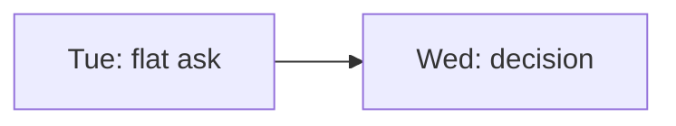

# Write docs

**How-to guide** — steps for one task you already know you want to do.

How to add or change a page on this site so it fits the rest.

## Build and preview locally

```sh
uv run --group docs zensical serve    # live preview on http://localhost:8000
uv run --group docs zensical build --strict    # what CI runs; warnings fail
```

The site source is `docs/`, its configuration and navigation are in `mkdocs.yml`. A new page
must be added to `nav` there.

## Pick the quadrant

The site follows [Diátaxis](https://diataxis.fr). Every page is exactly one of:

| Quadrant | Folder | Answers | Voice |
|---|---|---|---|
| Tutorial | `tutorials/` | "Teach me" — a lesson for a beginner | "We …", one path, every step shows what you should see |
| How-to guide | `how-to/` | "How do I …?" — one task, reader knows the goal | Imperative steps, no background |
| Reference | `reference/` | "What exactly is …?" — facts | Dry, complete, structured like the code |
| Explanation | `explanation/` | "Why …?" — understanding | Prose, may discuss alternatives |

If a page starts doing two jobs, split it and link between the parts. Each page starts with its
quadrant line (copy it from a page in the same folder).

## Rules

- **English**, but German chat texts (ODIN's replies, templates) are quoted verbatim, never
  translated.
- **Facts live in `reference/` once.** Command syntax, config keys, defaults, placeholders: other
  pages link to the reference instead of repeating them.
- **Behaviour changes update the docs.** A PR that changes something a user or operator notices
  updates the matching page in the same PR.
- **Include, don't copy, repo files.** `--8<-- "config.example.toml"` (pymdownx.snippets, paths
  relative to the repo root) keeps the page in sync with the file. A missing file fails the
  build.
- **Links are relative** (`../reference/cli.md`), so the strict build can check them.

## Chat mocks

Show what happens in Signal with a chat mock instead of a screenshot. It is plain HTML with
`markdown` attributes, so Markdown works inside the bubbles:

```html
<div class="chat" data-group="Flat group" markdown>
<div class="msg" markdown>
<span class="sender">Odin 🍽️</span>
Findet am Sonntag das offene Abendessen statt? 🍽️
<span class="reactions">👍 2</span>
</div>
<div class="msg me" markdown>
`/status`
</div>
</div>
```

<div class="chat" data-group="Flat group" markdown>
<div class="msg" markdown>
<span class="sender">Odin 🍽️</span>
Findet am Sonntag das offene Abendessen statt? 🍽️
<span class="reactions">👍 2</span>
</div>
<div class="msg me" markdown>
`/status`
</div>
</div>

- `data-group` (optional) shows the group name above the chat.
- `msg` is a message from someone else (left), `msg me` one from the reader (right).
- `sender` names who wrote it; `reactions` (optional) sits under the bubble.
- Take ODIN's texts from the real templates in `config.example.toml` (with the default schedule
  filled in) and from the German strings in `src/odin/commands/`, so the mock matches what
  people see.

## Diagrams

Mermaid works in fenced code blocks:

````md

````
